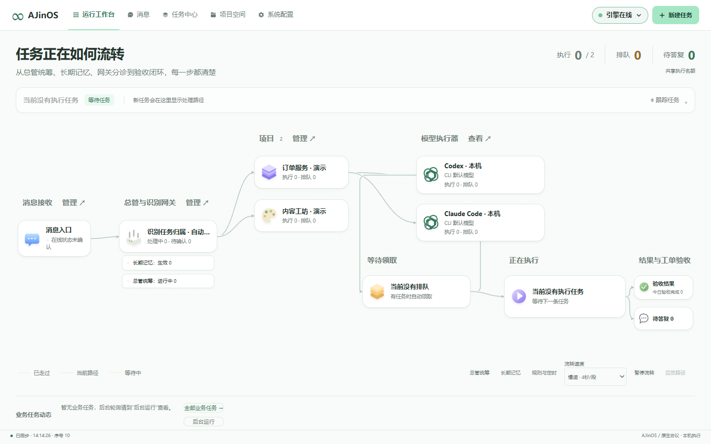
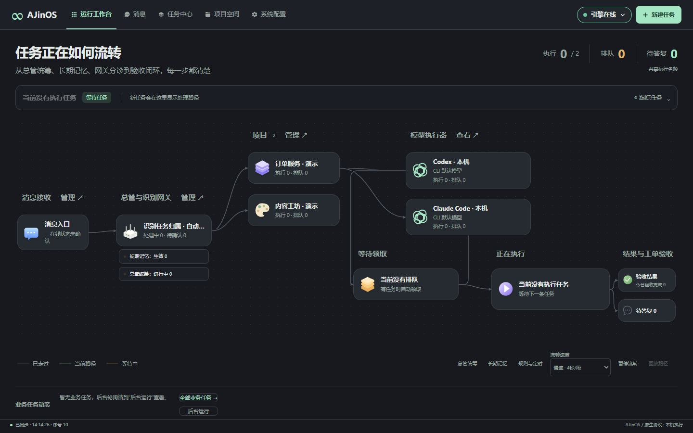
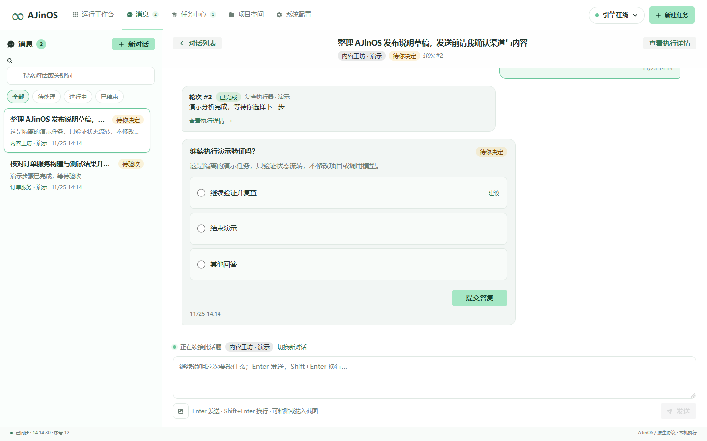
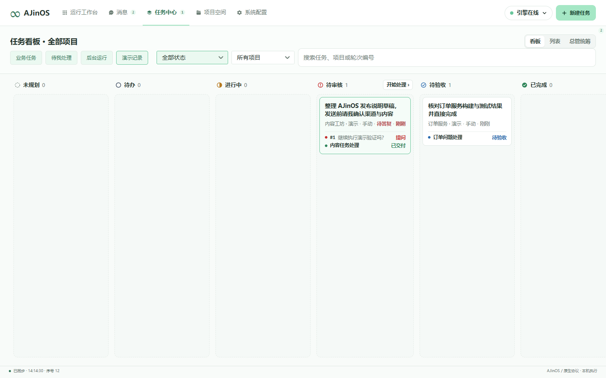
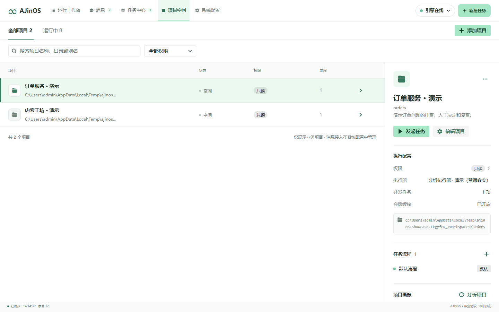
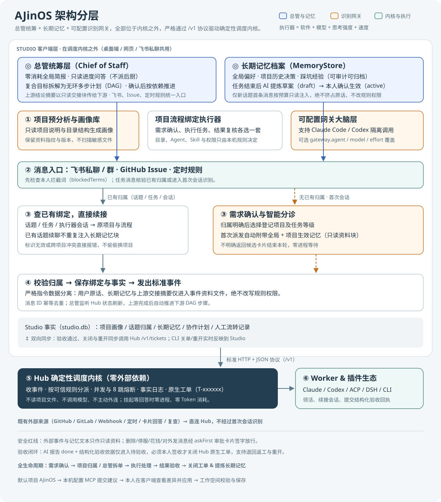

# AJinOS

**An open-source Agent automation hub and desktop workspace (AJinOS Studio), built on top of the deterministic [Agent Autoloop](https://github.com/KKKKhazix/agent-autoloop) kernel.**

Let command-line agents like Claude Code, Codex, and Antigravity pick up work and follow it through in the background — staying quiet when they can handle it, and sending you a card in the desktop workspace or chat channel only when a decision is yours to make.

[中文](README.md) | **English**

[Get started](#get-started) · [AJinOS Studio](#ajinos-studio) · [Support matrix](#platform-support) · [How it works](#how-it-works) · [Configuration](#day-to-day-configuration) · [Recipes](#ready-to-use-recipes) · [Plugins](#plugin-ecosystem) · [Kernel](#kernel-design) · [Repository layout](#repository-layout) · [Credits](#credits)

<picture>
  <source media="(prefers-color-scheme: dark)" srcset="docs/screenshots/workbench-dark.png" />
  <source media="(prefers-color-scheme: light)" srcset="docs/screenshots/workbench-light.png" />
  
</picture>

## What problem does it solve?

Most people use command-line agents like Claude Code or Codex by babysitting a terminal: type a prompt, watch it run, answer its questions. Close the window or walk away, and the work stops.

**AJinOS** pairs a zero-dependency deterministic scheduling kernel with a local visual desktop & web workspace:

- **AJinOS Studio (`client/`)**: a local desktop and web workspace featuring a live flow canvas, unified message center (text + image attachments and inline card approvals), 3-role routing (Plan / Execute / Verify with cooldown fallback and economy mode), project gateway, long-term memory, and Chief-of-Staff DAG planning.
- **Deterministic event-sourced kernel (`kernel/`)**: zero runtime dependencies, no outbound requests, and all state derived from an append-only SQLite fact log.
- **Pluggable & ticket-driven**: swap event sources, agents, channels, and CI/CD delivery freely; every piece of work carries a stable ticket number (e.g. `T-000123`) that only you can close.

One machine is enough — no cloud server and no inbound ports required.

## Highlights

- **Zero-cost wait**: while waiting for your decision, the agent process exits and state lives locally. Reply three days later and it resumes the original session with zero processes running and zero tokens spent in between.
- **3-role routing & automatic fallback**: bind installed Claude Code, Codex, or Antigravity (ACP) executors across Plan, Execute, and Verify roles with automatic cooldown fallback and economy mode. Models default to your CLI's own default unless you override them.
- **Built-in message center & workspace**: send tasks with screenshots, answer approval cards inline, inspect real-time progress, and accept or request rework right inside AJinOS Studio — no Feishu or external chat bot required.
- **Connect an agent in one line**: no SDK and no agent source changes. Any CLI tool that accepts a prompt and prints a final reply can connect.
- **One ticket per matter**: required flow steps (`flow`) gate acceptance, and only you can close a ticket.
- **Strict security boundaries**: external text goes only into local data files and never into prompts; rules alone decide which agent runs, where, and with what access.

## Platform support

| Component | Windows | macOS | Linux | Notes |
| --- | --- | --- | --- | --- |
| **Automation Hub Kernel & CLI** | ✅ Full support | ✅ Full support | ✅ Full support | Requires Node.js 24+ and Git |
| **AJinOS Studio Web Workspace** | ✅ Full support | ✅ Supported | ✅ Supported | Run `npm start` inside `client/`, open `http://127.0.0.1:3360` |
| **AJinOS Studio Desktop Installer** | ✅ Primary (`AJinOS-Setup-x64.exe`) | 🚧 PRs welcome | 🚧 PRs welcome | Run `npm run desktop` from source or use the web UI on macOS/Linux |

## Get started

You need **Node.js 24+** and **Git**, plus at least one signed-in CLI agent for real tasks. Studio also ships with a built-in demo executor so you can try the full workflow immediately without API keys or chat channels.

### Option 1: Launch AJinOS Studio (recommended)

**Windows installer** (self-contained with bundled Node.js 24 & Electron):
Download `AJinOS-Setup-x64.exe` from [Releases](https://github.com/ajin1024/AJinOS/releases), run it, and open **AJinOS**.

**Run from source (Windows / macOS / Linux)**:

```bash
git clone https://github.com/ajin1024/AJinOS.git
cd AJinOS/client
npm ci
npm start            # Opens local web workspace at http://127.0.0.1:3360
```

To launch the Electron desktop window:

```bash
npm run setup:desktop
npm run desktop
```

### Option 2: Headless CLI Hub

Windows PowerShell:

```powershell
irm https://raw.githubusercontent.com/ajin1024/AJinOS/main/install.ps1 | iex
```

macOS / Linux:

```bash
curl -fsSL https://raw.githubusercontent.com/ajin1024/AJinOS/main/install.sh | sh
```

The installer and `agent-autoloop update` both install the newest [release](https://github.com/ajin1024/AJinOS/releases). Then run a real loop with your own agent — ask, exit while it waits, make the call, resume:

```bash
agent-autoloop try
```

In an interactive terminal, type the option number. In a non-interactive terminal, run `agent-autoloop answer 1 2`. Then `agent-autoloop status` shows the resumed conversation, rounds, tokens, and cost.

## AJinOS Studio

The `client/` directory provides **AJinOS Studio**, a standalone desktop and local web client that talks to the hub strictly over the standard HTTP / SSE `/v1` protocol without altering the kernel:

| Light Theme · Live Workbench | Dark Theme · Live Workbench |
| --- | --- |
|  |  |
| **Message Center & Inline Approvals** | **Task Center Board & Acceptance** |
|  |  |

<details>
<summary>View Project Space & Studio Architecture Diagram</summary>





</details>

- **Live Workbench**: visualize projects, routing gateway, executors, queue reasons, and live task flow with light/dark/system themes.
- **Message Center & Approvals**: text + image attachments, inline card approvals, per-topic drafts, system tray alerts, and quick hotkey (`Alt + Shift + A`).
- **3-Role Routing & Configurable Models**: configure Claude Code, Codex, or Antigravity (ACP) across Plan / Execute / Verify roles; leaving model blank inherits your CLI's default.
- **Task Center & Chief of Staff**: unified inbox for pending items, board/list views, zero-token global briefs, Q&A, multi-ticket DAG plans, and owner acceptance synced to native Hub tickets.
- **Project Space & Long-Term Memory**: repository profiling, isolated project flows, and owner-approved memory archives.

See the [Studio guide](client/README.md) (Chinese) and [Studio architecture](docs/studio-architecture.md).

## How it works


1. **An event comes in.** A schedule, a GitHub issue, a production alert, or a Studio message becomes a standard event.
2. **Rules dispatch it.** `rules.json` decides which agent handles it and in which folder. Events for the same subject merge into one round while queued.
3. **The agent works one round and exits.** Its result goes in the final message, then the process exits.
4. **It asks only when needed.** For sensitive actions such as deleting data, restarting a service, spending money, or messaging people, the hub sends a card through Studio, Feishu, or a desktop notification. No process runs and no tokens are spent while waiting.
5. **One answer resumes it.** Your choice continues the original conversation.

Anything the agent can handle alone finishes directly, or schedules a follow-up check (for example in 30 minutes) without bothering you.

### Tickets and flows

All rounds of one matter hang on the same ticket, numbered like `T-000123`; the number never changes. A rule can pin down required steps:

```json
{
  "name": "Handle feedback",
  "when": { "source": "app", "types": ["feedback.*"] },
  "to": "codex",
  "cwd": "~/code/shop",
  "prompt": "Follow the process.",
  "parallel": 3,
  "flow": ["Intake", "Diagnose", "Fix", "Verify"]
}
```

Each round reports those steps by name with passed, failed, or unverified and the evidence. Until every required step has passed, the ticket cannot reach acceptance. Common commands:

```bash
agent-autoloop tickets                 # open tickets; --all includes closed ones
agent-autoloop ticket T-000003         # rounds and current state
agent-autoloop ticket close T-000003 --outcome completed --reason "checked and shipped"
agent-autoloop ticket reopen T-000003  # keeps the same number
```

## Day-to-day configuration

### Write rules (`rules.json`)

Open `~/.agent-autoloop/rules.json` and, under `rules`, declare **what happened, who handles it, and where they work**. Set `to` to a name already under `agents`.

A brief every morning at 9:

```json
{
  "name": "Morning brief",
  "when": { "cron": "0 9 * * *" },
  "to": "codex",
  "cwd": "~/notes",
  "prompt": "Summarize yesterday's notes and commits into today's brief."
}
```

External events work the same way once the source is registered under `sources` ([guide](skills/agent-autoloop/SKILL.md#接一个事件插件)). Changes take effect within seconds of saving; if the file is invalid or unreadable, the hub keeps the previous valid rules and sends you a card.

| Command | Purpose |
| --- | --- |
| `agent-autoloop check [file]` | Validate active config or a draft without touching the running hub |
| `agent-autoloop rules explain` | Show active rules and their next scheduled runs |
| `agent-autoloop emit <type> --dry-run` | Preview who an event would go to |
| `agent-autoloop run <rule>` | Run a rule once right now |
| `agent-autoloop pause / resume <rule>` | Pause or resume one rule |

### How agents talk back

The hub asks only one thing of an agent: **put your result in your final message**. To ask you something or trigger follow-up actions, append an `agent-autoloop` block:

````text
Order checked. We have enough stock in the warehouse.

```agent-autoloop
{
  "ask": [{
    "title": "How should we ship it?",
    "text": "Both options can go out today.",
    "options": ["Courier", "Pickup"],
    "key": "shipping"
  }]
}
```
````

Supported actions include asking (`ask`), notifying (`notice`), resolving cards (`resolve`), scheduling follow-up checks (`later`), and emitting new events (`events`). If the receipt JSON is invalid, the hub has the agent rewrite only that final message in the same session without repeating completed work.

## Ready-to-use recipes

Each recipe includes rules, a task Skill, and setup instructions.

| Task | Included workflow |
| --- | --- |
| [Morning brief](examples/recipes/morning-brief/README.md) | Summarize local notes and Git commits into `briefs/YYYY-MM-DD.md` |
| [GitHub issues](examples/recipes/github-issues/README.md) | Poll for new issues, edit code locally, and notify you to review |
| [Production alerts](examples/recipes/ops-alerts/README.md) | Receive an error, investigate code, ask before restarting |
| [User feedback](examples/recipes/feedback/README.md) | Re-read feedback, fix, deliver and verify, then prepare a reply |
| [Website watch](examples/recipes/website-watch/README.md) | Check status and content, wake the agent on incidents, update the card on recovery |
| [Feishu weekly brief](examples/recipes/feishu-brief/README.md) | Read selected reports and tables, summarize locally |
| [Inbox triage](examples/recipes/inbox-triage/README.md) | Read unread mail, write a checklist and reply drafts without sending or changing the mailbox |
| [PR delivery](skills/agent-autoloop/SKILL.md#交付流水线) | Add `deliver` to a PR to review, wait for CI, merge, and verify the live version |

To enable one: put the task Skill in your agent's skills directory, merge the sample rules into `~/.agent-autoloop/rules.json`, replace worker names and paths, then run `agent-autoloop check`.

## Plugin ecosystem

Built-in plugins ship with the program and are enabled through configuration. Use `agent-autoloop add <git URL>` for third-party plugins.

| Side | Built in | Setup |
| --- | --- | --- |
| **Events** | [GitHub Webhook](plugins/github/source.ts), [GitLab Webhook](plugins/gitlab/source.ts), [HTTP API](docs/protocol.md#来源把世界变成事件), [cron rules](skills/agent-autoloop/SKILL.md#改规则), [issue polling script](examples/watch-github-issues.sh) | [Guide](skills/agent-autoloop/SKILL.md#接一个事件插件) |
| **Agents** | [Claude Code](plugins/claude/agent.ts), [Codex](plugins/codex/agent.ts), [ACP](plugins/acp/agent.ts), [DeepSeek Harness](plugins/dsh/agent.ts), [generic command](plugins/command/agent.ts) | [Guide](skills/agent-autoloop/SKILL.md#接一个-agent) |
| **Channels** | [Desktop notifications](plugins/desktop/channel.ts) (on by default), [Feishu](plugins/feishu/channel.ts), [DingTalk / WeCom / Slack / Discord](plugins/webhook/templates.ts) | [Guide](skills/agent-autoloop/SKILL.md#接一个通道) |
| **Delivery** | [`delivery`](plugins/delivery/delivery.ts) | [Guide](skills/agent-autoloop/SKILL.md#交付流水线) |

**Other CLI agents connect in one line**: set `use: "command"` and pass a command array; `{prompt}` is a single argument, never evaluated as shell code.

| Agent | Command |
| --- | --- |
| DeepSeek Harness (built-in plugin needs 0.2.2 or newer) | `dsh --profile headless {prompt}` |
| pi | `pi --print {prompt}` |
| OpenClaw | `openclaw agent exec {prompt}` |
| Hermes | `hermes chat -Q -q {prompt}` |
| Cursor | `agent -p --trust {prompt}` |
| WorkBuddy / CodeBuddy | `codebuddy -p {prompt}` |

Agents that speak ACP connect with `use: "acp"`, for example Gemini CLI (`["gemini", "--acp"]`), OpenCode (`["opencode", "acp"]`), and Antigravity (`["agy", "acp"]`).

**Write your own**: start from the runnable [agent](examples/plugins/hello-agent/agent.ts), [channel](examples/plugins/hello-channel/channel.ts), and [event](examples/plugins/hello-source/source.ts) templates and the [plugin guide](docs/plugins.md).

## Kernel design

The kernel is about 1,850 lines with zero runtime dependencies, applying four proven systems patterns to command-line agents:

- **Zero-cost wait**: the process exits while waiting, and the waiting state lives in the database.
- **Event sourcing**: all state is derived from an append-only log, with the log and indexes committed in one transaction.
- **Code / data split**: external text is written only to local data files, never into the prompt; rules alone decide which agent runs, where, and with what access.
- **Hop circuit breaker**: events returned by agents can dispatch more agents; past 8 hops the kernel records the event, stops dispatching, and notifies you.

### Check it yourself

| What it checks | Command |
| --- | --- |
| The full story of any round | `agent-autoloop why 1` |
| 200,000 simulated steps of network loss, crashes, and duplicate requests | `node sim/random.ts 24301 200000` |
| 1,000 process kills with no acknowledged record lost | `node sim/crash.ts 1000 12648430` |
| Benchmarks | `npm run benchmark` |
| Studio bundle check & unit tests | `npm run check --prefix client && npm test --prefix client` |

Development guidelines are in [AGENTS.md](AGENTS.md). On Windows use `npm run test:windows` and `node scripts/install-smoke-windows.ts`.

## Usage and provider terms

The hub invokes command-line tools you have already installed and signed into; it never reads or exports their credentials. Model usage is billed to your own account. For automated workloads, use API keys. This project is independent and is not affiliated with or endorsed by model providers.

## Repository layout

| Location | Contents |
| --- | --- |
| `client/` | **AJinOS Studio** desktop client and local web workspace |
| `kernel/` | Decisions, fact log, projections, deadlines, rule matching, endpoint behavior, and card forms |
| `host/` | Node HTTP, files and SQLite connections, clock, configuration, status summary, background services, and plugin loading |
| `protocol/` | Wire formats, JSON Schema, input validation, HTTP client, and conformance checks |
| `worker/` | Claim work, run agents, handle heartbeats and cancellation, read and submit receipts |
| `cli/`, `bin/` | User commands and entry point |
| `plugins/` | Built-in agent, event, channel, and delivery plugins |
| `examples/` | Recipes, minimal plugin templates, and task Skills |
| `skills/agent-autoloop/` | The hub's configuration and operation manual |
| `docs/` | Protocol, plugin guide, Studio architecture, and architecture diagrams |
| `tests/`, `sim/` | Behavior tests, simulation, enumeration, crash tests, and mutation checks |
| `scripts/`, `.github/workflows/` | Performance and real-agent checks, installation smoke scripts, and CI |

## Documentation

- [AJinOS Studio guide](client/README.md)
- [Installation guide](INSTALL.md)
- [Configuration & delivery pipeline manual](skills/agent-autoloop/SKILL.md)
- [Writing plugins](docs/plugins.md)
- [Full HTTP protocol specification](docs/protocol.md)
- [Security boundaries](SECURITY.md)
- [Contributing and community](CONTRIBUTING.md)

## Credits

AJinOS's zero-dependency deterministic kernel, event-sourcing protocol, and plugin system are built on top of **Agent Autoloop** (MIT License) by [数字生命卡兹克 (KKKKhazix)](https://github.com/KKKKhazix). AJinOS extends it with the AJinOS Studio desktop & web workspace, 3-role routing and cooldown fallback, unified message center, project gateway, long-term memory, and Chief-of-Staff orchestration while staying strictly compatible with the upstream kernel boundaries and `/v1` protocol.

---

[MIT License](LICENSE)
