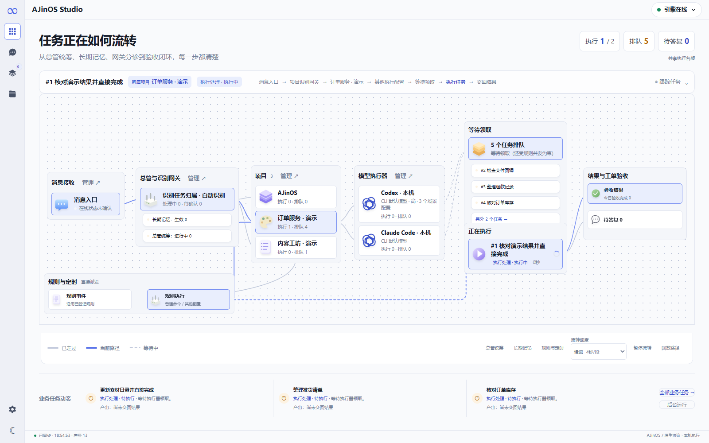
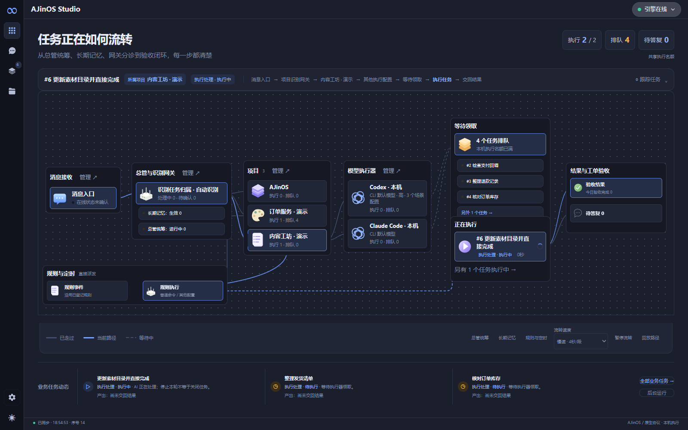
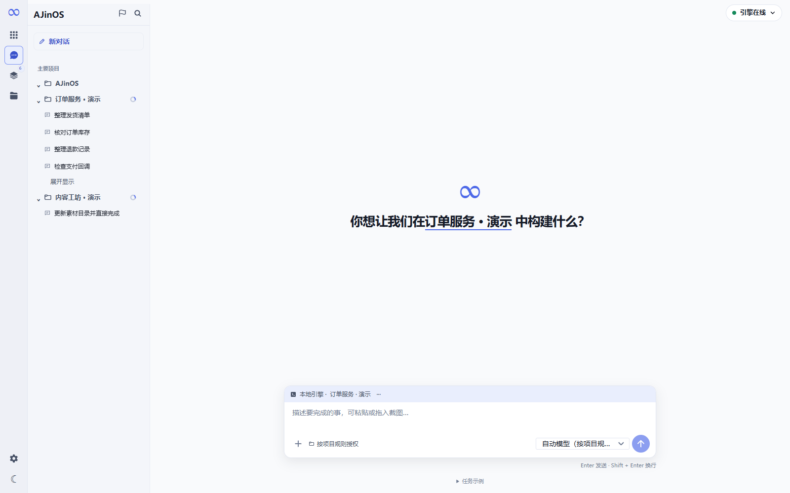
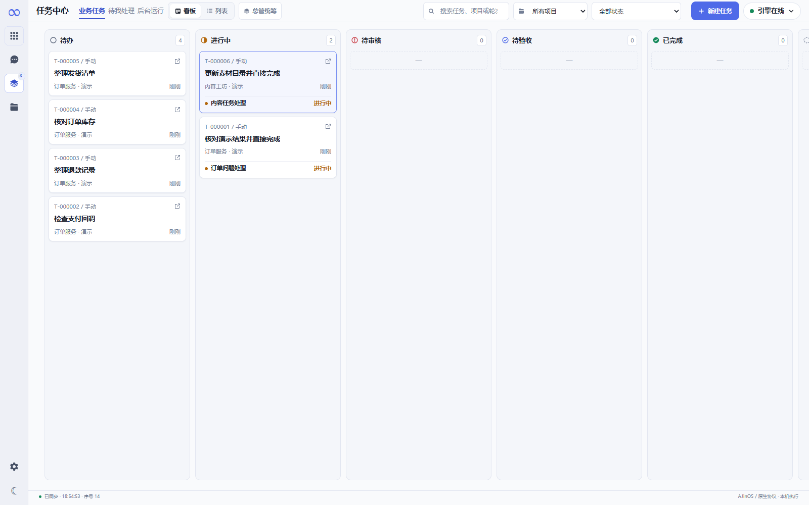
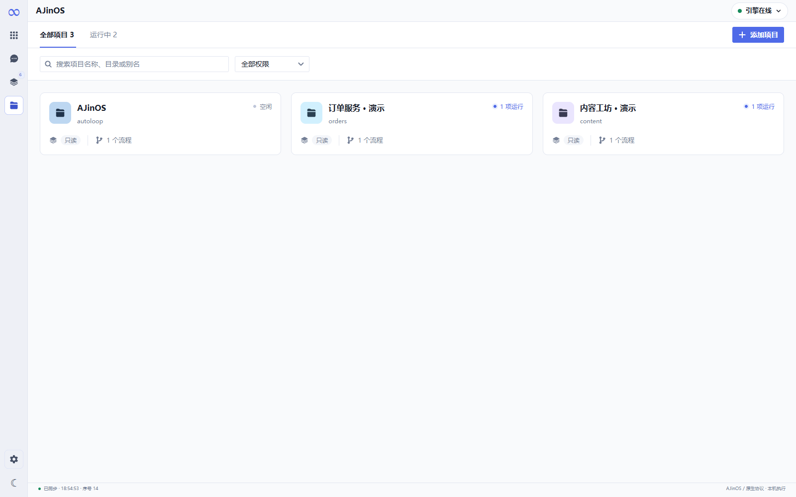
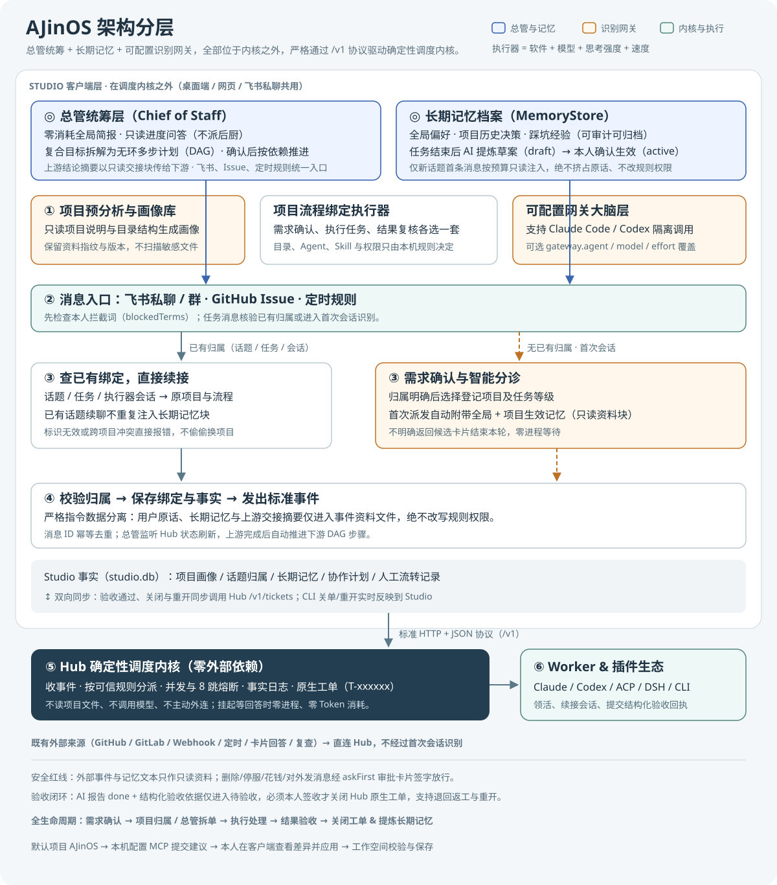

# AJinOS

**基于 [Agent Autoloop](https://github.com/KKKKhazix/agent-autoloop) 确定性内核构建的开源 Agent 自动化中台与桌面工作台（AJinOS Studio）。**

让 Claude Code、Codex、Antigravity 等命令行 Agent 在后台自动接活、跨轮次跟进到底；能自己搞定的事安静闭环，需要你拍板时才通过桌面工作台、消息中心或飞书/钉钉卡片找你。

**中文** | [English](README.en.md)

[快速开始](#快速开始) · [AJinOS Studio 工作台](#ajinos-studio-工作台) · [支持矩阵](#平台支持矩阵) · [工作原理](#工作原理) · [日常配置](#日常配置) · [场景模板](#场景模板) · [插件体系](#插件体系) · [内核设计](#内核设计) · [目录结构](#目录结构) · [致谢](#致谢)

<picture>
  <source media="(prefers-color-scheme: dark)" srcset="docs/screenshots/workbench-dark.png" />
  <source media="(prefers-color-scheme: light)" srcset="docs/screenshots/workbench-light.png" />
  
</picture>

## 它解决什么问题

用 Claude Code、Codex 这类命令行 Agent 时，大多数人还在“人守着终端”：输入一句话，盯着它跑，等它问下一步。一旦关掉窗口或离开电脑，任务就断了。

**AJinOS** 把“零依赖调度内核”和“可视化本地工作台”结合成一套本机可运行的 Agent 操作系统：

- **AJinOS Studio 桌面与网页工作台（`client/`）**：提供实时运行画布、统一消息中心（图文提问与行内卡片审批）、三角色模型调度（规划 / 执行 / 校验 + 自动降级与省钱模式）、项目识别网关、长期记忆与总管统筹。
- **确定性事件溯源内核（`kernel/`）**：继承 Agent Autoloop 的零外部依赖设计，不主动联网、不绑死任何产品，状态全部从只追加事实日志派生。
- **插件化与工单闭环**：事件来源、Agent、通知通道和代码交付流水线皆可热插拔；每件事拥有固定编号工单（如 `T-000123`），只有本人验收后才能关单。

一台电脑即可运行，不需要云服务器，也不用开放公网端口。

## 核心特性

- **挂起零消耗**：等你拍板时 Agent 进程直接退出，等待状态保存在本地数据库。三天后回复也会接上原会话继续执行，期间不占进程、不花 Token。
- **三角色调度与自动降级**：按「规划 · 执行 · 校验」分工绑定已登录的 Claude Code、Codex 或 Antigravity（ACP），支持首选/备选冷却降级与省钱模式；默认沿用本机 CLI 模型，不硬编码私有模型名。
- **一体化消息中心与工作台**：不配飞书也能在 AJinOS Studio 内发图文需求、行内点卡片拍板、查看实时流转路径、人工验收或退回返工。
- **一行配置接 Agent**：无需 SDK、无需修改 Agent 源码，任何命令行工具都可通过内置插件、ACP 协议或通用命令接入。
- **每件事一张工单**：可定义必做流程步骤（`flow`），必做项未全部核验通过不能进入待验收，最终关闭权只属于你。
- **安全边界清晰**：指令与资料分离，外部消息文本只写入本地资料文件，绝不拼进提示词或决定目录与权限；内核支持 8 跳熔断防死循环。

## 平台支持矩阵

| 模块 | Windows | macOS | Linux | 说明 |
| --- | --- | --- | --- | --- |
| **自动化中台内核与 CLI** | ✅ 完整支持 | ✅ 完整支持 | ✅ 完整支持 | 需要 Node.js 24+ 与 Git |
| **AJinOS Studio 网页工作台** | ✅ 完整支持 | ✅ 支持 | ✅ 支持 | 在 `client/` 运行 `npm start`，浏览器访问 `127.0.0.1:3360` |
| **AJinOS Studio 桌面安装包** | ✅ 优先支持（`AJinOS-Setup-x64.exe`） | 🚧 欢迎贡献 | 🚧 欢迎贡献 | macOS/Linux 可从源码跑 `npm run desktop` 或使用网页版 |

## 快速开始

需要 **Node.js 24+**、**Git**；真实任务执行需至少登录一个本机命令行 Agent（如 Claude Code、Codex 或 ACP 兼容工具）。首次启动 Studio 可直接使用内置演示执行器零配置体验，无需先配置 API Key 或飞书。

### 方式一：启动 AJinOS Studio 工作台（推荐）

**Windows 安装包**（零环境依赖，内置 Node.js 24 与 Electron）：
前往 [Releases](https://github.com/ajin1024/AJinOS/releases) 下载 `AJinOS-Setup-x64.exe` 双击安装，打开「AJinOS」即可体验。

**从源码启动（Windows / macOS / Linux）**：

```bash
git clone https://github.com/ajin1024/AJinOS.git
cd AJinOS/client
npm ci
npm start            # 启动本地网页工作台：http://127.0.0.1:3360
```

如需启动 Electron 桌面窗口：

```bash
npm run setup:desktop
npm run desktop
```

### 方式二：纯命令行中台（CLI）

Windows PowerShell：

```powershell
irm https://raw.githubusercontent.com/ajin1024/AJinOS/main/install.ps1 | iex
```

macOS / Linux：

```bash
curl -fsSL https://raw.githubusercontent.com/ajin1024/AJinOS/main/install.sh | sh
```

安装和 `agent-autoloop update` 都会安装最新的 [Release](https://github.com/ajin1024/AJinOS/releases)。装好后用本机 Agent 走一遍“提问 → 退出等回复 → 拍板 → 接着干完”：

```bash
agent-autoloop try
```

交互终端里直接输入数字回车；非交互终端运行 `agent-autoloop answer 1 2`。再运行 `agent-autoloop status`，可以看到它接上原会话并显示今天的轮数、Token 和费用。

## AJinOS Studio 工作台

`client/` 目录提供独立的桌面与本地网页客户端 **AJinOS Studio**。它完全通过标准 Hub HTTP / SSE 协议工作，不修改中台内核与调度协议：

下图取自隔离的本地 Studio，任务与项目为演示数据。

| 瓷白蓝紫 · 工作台 | 深蓝灰 · 工作台 |
| --- | --- |
|  |  |
| **消息中心与项目对话** | **任务中心看板与验收** |
|  |  |

<details>
<summary>查看项目空间与 Studio 架构分层图</summary>





</details>

- **工作台**：实时可视化展示业务项目、项目识别网关、执行器、排队原因与流转路径，支持日夜/跟随系统主题。
- **消息中心与审批**：支持文字与图片粘贴/拖入、行内卡片答复、话题草稿保留、系统托盘提醒与全局快捷键（`Alt + Shift + A`）。
- **三角色调度与模型自由配置**：按规划 / 执行 / 校验配置已登录的 Claude Code、Codex、Antigravity（ACP），模型留空即沿用本机 CLI 默认。
- **任务中心与总管统筹**：聚合「待我处理」、看板/列表、零消耗全局简报、进度问答与多工单 DAG 协作计划，验收关闭同步 Hub 原生工单。
- **项目空间与长期记忆**：项目画像预分析、自定义流程与权限隔离、经本人确认后生效的长期记忆档案。

详见 [AJinOS Studio 使用说明](client/README.md) 与 [Studio 架构说明](docs/studio-architecture.md)。

- **AJinOS 配置助手**。首次初始化只创建默认项目 AJinOS。项目通过安装包自带的 MCP 提交配置建议，用户在桌面端审核并应用。

## 工作原理


1. **事件进来**：定时任务、GitHub Issue、业务系统报错或 Studio 消息被转换成标准事件，送入内核。
2. **按规则派活**：内核根据 `rules.json` 决定交给哪个 Agent、在哪个目录执行；同一事项排队期间的新消息会合并成一轮。
3. **干完一轮就退出**：Agent 把结果写在最后一条回复里，进程随即退出。
4. **拿不准才问你**：删除数据、重启服务、花钱、对外发消息等敏感操作，内核通过工作台、飞书或桌面通知发卡片。等待期间不占进程、不花 Token。
5. **点一下接着干**：你做出选择后，它接上原来的会话继续完成。

能自己搞定的事直接闭环：办完，或约定时间（例如半小时后）再醒来复查，全程不打扰你。

### 工单与流程

同一事项的每一轮都挂在同一张工单上，号码从开单到关闭不变。规则可以固定必做步骤：

```json
{
  "name": "处理反馈",
  "when": { "source": "app", "types": ["feedback.*"] },
  "to": "codex",
  "cwd": "~/code/shop",
  "prompt": "按流程处理。",
  "parallel": 3,
  "flow": ["受理", "定位", "修复", "验证"]
}
```

Agent 每轮按名字报告步骤是否通过及依据。必做步骤未全部通过时，工单不能进入待验收。常用命令：

```bash
agent-autoloop tickets                 # 开着的工单；--all 包含已关闭
agent-autoloop ticket T-000003         # 查看一张工单
agent-autoloop ticket close T-000003 --outcome completed --reason "已核对上线"
agent-autoloop ticket reopen T-000003  # 号码不变
```

## 日常配置

### 写规则（`rules.json`）

打开 `~/.agent-autoloop/rules.json`，在 `rules` 中写清楚**什么事、交给谁、在哪个目录干**。`to` 填 `agents` 中已有的名字。

每天早上 9 点写早报：

```json
{
  "name": "早报",
  "when": { "cron": "0 9 * * *" },
  "to": "codex",
  "cwd": "~/notes",
  "prompt": "整理昨天的笔记和提交，写今天的早报。"
}
```

外部事件写法相同，先按[说明](skills/agent-autoloop/SKILL.md#接一个事件插件)在 `sources` 中登记来源。保存后几秒内自动生效；配置写错时会继续按旧规则运行并发卡片提醒。

| 命令 | 作用 |
| --- | --- |
| `agent-autoloop check [文件]` | 检查生效配置或草稿，不影响正在运行的中台 |
| `agent-autoloop rules explain` | 查看当前生效规则和下次定时 |
| `agent-autoloop emit <类型> --dry-run` | 预演事件会派给谁 |
| `agent-autoloop run <规则>` | 立即手动跑一轮 |
| `agent-autoloop pause / resume <规则>` | 暂停或恢复一条规则 |

### Agent 如何回传结果

中台对 Agent 只有一个约定：**在最后一条回复里交代结果**。需要请示或调度后续动作时，在回复末尾附一个 `agent-autoloop` 代码块：

````text
订单已经核对完毕，库存充足。

```agent-autoloop
{
  "ask": [{
    "title": "怎么发货？",
    "text": "两种方式今天都能发出。",
    "options": ["快递", "自提"],
    "key": "shipping"
  }]
}
```
````

支持的动作包括：提问（`ask`）、通知（`notice`）、关闭卡片（`resolve`）、预约复查（`later`）和触发新事件（`events`）。回执 JSON 写错时，中台会让 Agent 在同一会话中重写最后一段，不重复已完成的业务。

## 场景模板

每套模板都包含规则、任务 Skill 和启用说明。

| 想做什么 | 已经封装好的流程 |
| --- | --- |
| [每日早报](examples/recipes/morning-brief/README.md) | 每天整理本地笔记和 Git 提交，写入 `briefs/YYYY-MM-DD.md` |
| [跟进 GitHub Issue](examples/recipes/github-issues/README.md) | 定时查新 Issue，在本地改代码并通知你查看 |
| [线上告警排查](examples/recipes/ops-alerts/README.md) | 接收报错、对照代码查原因，需要重启时发卡片询问 |
| [用户反馈处理](examples/recipes/feedback/README.md) | 重读反馈、修复、交付核实、准备回复 |
| [网站巡检](examples/recipes/website-watch/README.md) | 定时检查状态和关键内容，异常时交给 Agent，恢复后更新卡片 |
| [飞书周报与业务摘要](examples/recipes/feishu-brief/README.md) | 按权限读取汇报和表格，生成本地摘要 |
| [收件箱分诊](examples/recipes/inbox-triage/README.md) | 读取未读邮件，生成清单和回复草稿，不发送、不改邮箱状态 |
| [PR 自动交付](skills/agent-autoloop/SKILL.md#交付流水线) | 打上 `deliver` 标签后，审查、等 CI、合并、等发布并核对线上版本 |

启用方式：打开对应说明，把任务 Skill 放进所用 Agent 的 skills 目录，把示例规则合入 `~/.agent-autoloop/rules.json`，替换电脑名和路径，再运行 `agent-autoloop check`。

## 插件体系

内置插件随程序安装，配置后启用；第三方插件用 `agent-autoloop add <git 地址>` 安装。

| 方向 | 内置 | 配置 |
| --- | --- | --- |
| **事件**：怎么发现新活 | [GitHub Webhook](plugins/github/source.ts)、[GitLab Webhook](plugins/gitlab/source.ts)、[HTTP 接口](docs/protocol.md#来源把世界变成事件)、[定时规则](skills/agent-autoloop/SKILL.md#改规则)、[Issue 轮询脚本](examples/watch-github-issues.sh) | [说明](skills/agent-autoloop/SKILL.md#接一个事件插件) |
| **Agent**：谁来干活 | [Claude Code](plugins/claude/agent.ts)、[Codex](plugins/codex/agent.ts)、[ACP](plugins/acp/agent.ts)、[DeepSeek Harness](plugins/dsh/agent.ts)、[通用命令](plugins/command/agent.ts) | [说明](skills/agent-autoloop/SKILL.md#接一个-agent) |
| **通道**：去哪找你拍板 | [桌面通知](plugins/desktop/channel.ts)（默认开启）、[飞书](plugins/feishu/channel.ts)、[钉钉 / 企微 / Slack / Discord](plugins/webhook/templates.ts) | [说明](skills/agent-autoloop/SKILL.md#接一个通道) |
| **交付**：CI/CD 插件 | [`delivery`](plugins/delivery/delivery.ts) | [说明](skills/agent-autoloop/SKILL.md#交付流水线) |

**其他命令行 Agent 一行接入**：设置 `use: "command"` 并传入命令数组，`{prompt}` 作为独立参数传递，不作为 shell 代码执行。

| Agent | 接入命令 |
| --- | --- |
| DeepSeek Harness（内置插件需 0.2.2 或更新） | `dsh --profile headless {prompt}` |
| pi | `pi --print {prompt}` |
| OpenClaw | `openclaw agent exec {prompt}` |
| Hermes | `hermes chat -Q -q {prompt}` |
| Cursor | `agent -p --trust {prompt}` |
| WorkBuddy / CodeBuddy | `codebuddy -p {prompt}` |

会说 ACP 的 Agent 用 `use: "acp"` 接入，例如 Gemini CLI（`["gemini", "--acp"]`）、OpenCode（`["opencode", "acp"]`）和 Antigravity（`["agy", "acp"]`）。

**写自己的插件**：从 [Agent](examples/plugins/hello-agent/agent.ts)、[通道](examples/plugins/hello-channel/channel.ts)、[事件](examples/plugins/hello-source/source.ts) 三个可运行的最小模板开始，并参考[插件开发说明](docs/plugins.md)。

## 内核设计

内核约 1850 行代码、零运行时依赖，把四个成熟的系统设计用到命令行 Agent 上：

- **挂起零消耗**：等待拍板时进程退出，等待状态存在数据库里。
- **事件溯源**：所有状态从只追加的日志计算，日志和索引在同一事务中写入磁盘。
- **指令数据分离**：外部文字只作为资料放进文件，不拼进提示词；用哪个 Agent、在哪个目录、什么权限只由本机规则决定。
- **跳数熔断**：Agent 交回的事件可以继续派发，层数一路累加，超过 8 层只记录不再派活。

### 自己验证

| 验证什么 | 命令 |
| --- | --- |
| 任何一轮的来龙去脉 | `agent-autoloop why 1` |
| 20 万步模拟断网、丢包、崩溃和重复提交 | `node sim/random.ts 24301 200000` |
| 强杀进程 1000 次，已确认记录不丢 | `node sim/crash.ts 1000 12648430` |
| 性能基准 | `npm run benchmark` |
| Studio 前端构建校验与单元测试 | `npm run check --prefix client && npm test --prefix client` |

测试与开发约定见 [AGENTS.md](AGENTS.md)。Windows 可运行 `npm run test:windows` 和 `node scripts/install-smoke-windows.ts`。

## 用量与合规

中台直接调用本机已安装并登录的命令行工具，不会读取或转存账号凭据。模型调用消耗算在你自己的账号名下。高频自动化场景建议使用 API Key；对外提供服务时请使用 API Key。本项目为独立开源项目，与模型厂商无隶属或背书关系。

## 目录结构

| 位置 | 放什么 |
| --- | --- |
| `client/` | **AJinOS Studio** 桌面客户端与本地网页工作台 |
| `kernel/` | 确定性内核：决策、事实日志、状态投影、到期任务、规则匹配、接口行为与卡片表单 |
| `host/` | 运行外壳：Node HTTP、文件与 SQLite 连接、时钟、配置、状态汇总、后台服务和插件加载 |
| `protocol/` | 通信格式、JSON Schema、输入校验、HTTP 客户端和一致性检查 |
| `worker/` | 接单程序：领活、运行 Agent、心跳与停止、读取和提交回执 |
| `cli/`、`bin/` | 用户命令及启动入口 |
| `plugins/` | 内置 Agent、事件、通道和交付插件 |
| `client/` | 可选的 AJinOS 桌面客户端与本地网页前端 |
| `examples/` | 场景模板、最小插件模板和任务 Skill |
| `skills/agent-autoloop/` | 中台的正式配置与操作手册 |
| `docs/` | 通信协议、插件开发、Studio 架构与架构图 |
| `tests/`、`sim/` | 行为测试、模拟、穷举、强杀和变异检查 |
| `scripts/`、`.github/workflows/` | 性能与真机验证、安装冒烟脚本和 CI |

## 更多文档

- [AJinOS Studio 工作台说明](client/README.md)
- [安装说明](INSTALL.md)
- [规则与交付流水线配置手册](skills/agent-autoloop/SKILL.md)
- [如何编写插件](docs/plugins.md)
- [完整通信协议](docs/protocol.md)
- [安全边界说明](SECURITY.md)
- [参与贡献与交流](CONTRIBUTING.md)

## 致谢

AJinOS 的零依赖调度内核、事件溯源协议与插件体系基于 [数字生命卡兹克](https://github.com/KKKKhazix) 开源的 **Agent Autoloop**（MIT License）构建。在此基础上，AJinOS 持续扩展了桌面与本地网页工作台（AJinOS Studio）、三角色模型调度与降级、消息中心、项目识别网关、长期记忆与总管统筹等能力，并严格保持对上游内核边界与 `/v1` 协议的兼容。

---

[MIT License](LICENSE)
