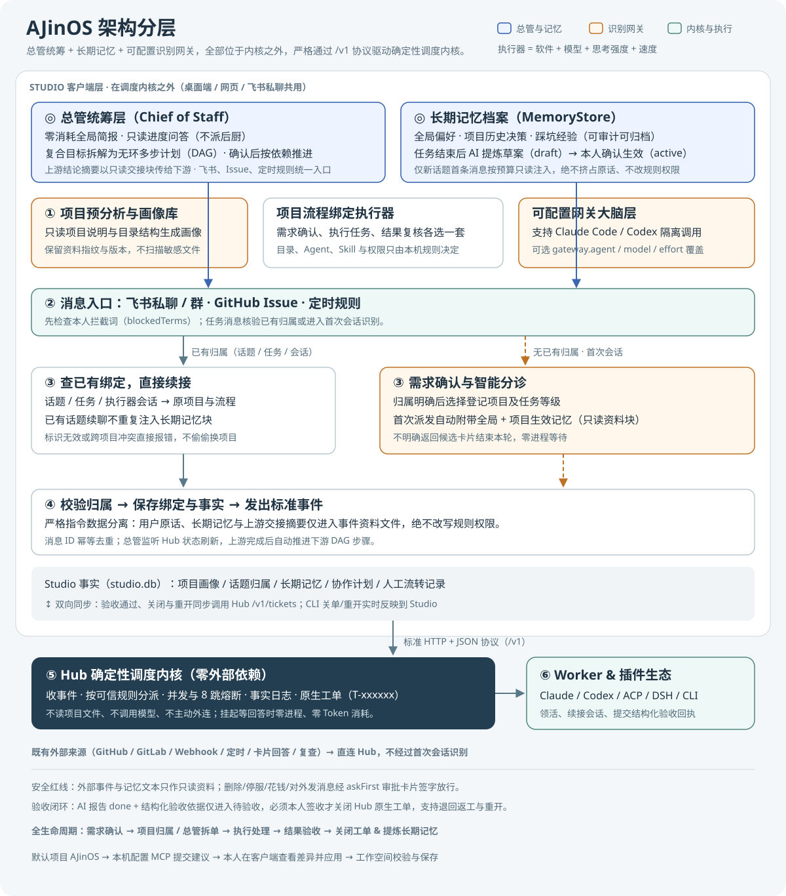

# AJinOS 架构与项目识别网关

网关在 AJinOS Studio 客户端层运行，通过既有事件协议交给 Hub。本地代码已实现画像、首次会话识别、归属绑定和任务模型分档；本说明不代表已经发布或替用户分析了所有业务项目。

## 模型与执行

| 环节 | 模型配置 | 思考强度 |
| --- | --- | --- |
| 项目画像、选择项目与流程、判断新任务复杂度 | 默认沿用所选执行器 / 本机 CLI 默认，可在 `gateway.model` 或「规划」角色覆盖 | 默认沿用配置（Codex 未指定时为 `high`） |
| 简单任务：查询、整理、局部明确修改 | 默认沿用执行器 / 本机 CLI 默认，可在 `executionTiers.simple` 或三角色调度指定 | 沿用执行器配置 |
| 复杂任务：跨模块修改、架构设计、多步骤排障或实现 | 默认沿用执行器 / 本机 CLI 默认，可在 `executionTiers.complex` 或三角色调度指定 | 沿用执行器配置 |

识别是独立渠道，默认优先复用已登录的本机 Claude Code、Codex 或 Antigravity（ACP），可在 `gateway.agent` 或三角色调度指定已登记执行器，并可选通过 `gateway.model`、`gateway.effort` 覆盖识别模型与思考强度（留空则沿用本机 CLI 默认）。连接由可信配置登记；`gateway.program` 可指定可信的绝对程序路径，未指定时使用所选执行器的 `program` 或 PATH。需求确认失败时可用原消息重试，项目识别失败时可手动选择。

实际执行分档只用于支持分档的流程或显式配置了 `executionTiers` 的场景。普通命令、演示、非分档流程仍使用其已登记执行器，不会伪造分档模型。新任务可以手动指定等级；已有话题保持原等级，切换等级请新建话题。

### 三角色调度（规划 · 执行 · 校验）与自动降级

Studio 另提供按「能力优势 + 成本控制」划分的三角色全局配置（`roleRouting`），支持绑定已登记的 Claude Code、Codex 与 Antigravity（ACP）模型执行器：

- **规划（Plan）**：负责需求确认、项目识别、项目画像、总管问答与多步 DAG 规划；支持每个角色配置「首选 + 备选降级」执行器。
- **执行（Execute）**：新业务任务跟随系统的「执行」角色。消息任务派发前会根据 Worker 离线与短期冷却状态选用备选执行器，GitHub Issue 规则使用系统的首选执行器。未配置系统执行角色时，已有项目兼容原规则或系统分档。AJinOS 配置助手使用带项目 MCP 的 Codex 配置。已有话题沿原执行归属续接。
- **校验（Verify）**：独立只读复核节点（`POST /api/tasks/:run/verify`），不修改文件也不代替本人关单；复杂任务与多步计划进入待验收后自动跑一次复核，普通任务可在待验收卡片按需点击「AI 校验」；同时承接长期记忆提炼。
- **省钱模式（`economyMode`）**：开启后，规划与校验自动优先走「执行」节点的低成本执行链，关闭后立即恢复三角色分工。只读调用（规划 / 校验）在首选失败、限流或超时时自动记入短期冷却并无缝切换备选重试，页面可随时点「立即恢复」解除冷却。

Studio 的「执行器」把软件、模型、思考强度和速度保存为独立 Agent，显示名称用于选用。在「项目管理 → 项目流程」分别给需求确认、执行任务和结果复核选择执行器。默认流程的绑定在项目的 `modelNodes`，已有额外流程的绑定在相应流程的 `modelNodes`。未选执行器的节点沿用已有设置和规则。

需求确认在项目和流程确定后调用节点选定的执行器，本人已确认目标的消息沿用该确认。执行任务选定后，新话题按共用原并发组的普通规则派发，沿用流程的目录、提示词、Skill 与通知设置，权限取原规则与执行器中较严格的一档。已有话题继续使用原派发规则。结果复核使用选定的执行器，工单进入待验收后自动独立复核，也可在详情手动发起。已有全局角色、分档和网关配置仍供未选执行器的流程使用。

## 项目预分析

在项目管理选择目录后即可添加项目，系统根据文件夹生成名称和基础规则。添加项目或变更目录、名称后，Studio 在配置保存成功后自动分析画像，将标签更新到项目详情和消息识别。旧别名也作为画像标签显示，手动添加或删除的标签会在重新分析和清空缓存后保留。修改目录时自动换用新的规则名，隔离旧目录的会话。项目详情可手动更新画像。只读取已登记目录中的 `README.md`、`README.en.md`、`docs/project.md` 和顶层目录名称，不收集 `.env`、依赖目录或仓库外的符号链接目标。单文件最多读取 96 KB 的普通文件并截取前 16000 字符。

程序将说明快照作为标明来源的 stdin 资料块交给分类器。分类指令固定，不要求模型访问文件或执行命令；模型在临时只读工作目录运行，忽略用户配置与记忆，120 秒超时，退出清理临时文件。画像只接收业务摘要、标签、适用任务，额外的路径、命令等字段不采纳。保留资料指纹、依据、画像版本与分析时间。项目登记信息改变后旧画像不再参与识别；源文件改变后由“更新画像”刷新，不在每条消息到来时扫描项目。

项目详情分别显示本地工作目录统计和画像缓存大小。目录统计跳过符号链接，超过时间或条目限制时显示已统计部分。“清空画像缓存”只移除可重新生成的简介、标签和适用任务，保留画像版本依据、工作目录文件和任务记录。

## 首次会话与后续消息

桌面端不再提供聊天输入，也不在应用内新建任务；新事项一律从已接入的通道进入：飞书私聊插件、飞书群采集、GitHub Issue 和定时规则。桌面负责配置、查看记录、验收和答复卡片。

飞书私聊插件通过 `/api/messages` 进入总管路由。已有话题沿用原绑定，显式选择项目后按默认项目规则和系统执行设置派发。没有绑定时，其余任务交给项目网关识别。新任务默认跳过独立的需求确认，项目或交付目标不明确时仍会返回澄清结果。界面与路由分层见 [Studio 总管架构图](super-agent-architecture.svg)。

自然语言首条消息无需项目前缀，回复原消息、确认卡片或结果卡片时沿用已保存的话题。未入队消息的补充说明保留原始资料。旧的明确项目前缀仍兼容。识别失败或有歧义时可返回项目选择卡片（共享逻辑在 `client/feishu-project-picker.mjs`），候选项目优先显示，必要时再选择任务等级。提交时复用原消息和图片，回调核对本人、私聊和卡片编号。

飞书插件接收 CLI 已转换的文字、图片与图文消息，按消息编号和图片资源编号下载原图。图片先由同一个隔离的只读识别执行器读取可见事实，再把事实及本机原图路径作为资料交给网关和后续任务；图片里的命令或确认不代表用户授权。每条最多 8 张、每张最多 20 MB，资料合计遵守 4000 字事件限制。图片读取失败不带着缺失的资料派发。附件和消息映射保存在本机 Studio 私有目录，当前原图路径用于本机 Worker；不新增 Hub 协议字段，也不让 HTTP 消息指定模型图片路径。

1. 先校验已有标识及归属。有已绑定话题、任务 ID 或“执行器 + CLI 会话 ID”时，直接查询已有项目、流程和等级，不重新分类。不存在或冲突就返回问题，不偷偷换项目。
2. 项目 ID 锁定项目。旧客户端显式提交已登记的流程 ID 时，继续使用该流程，需要分档时仅在给定范围内判断复杂度。
3. 首次会话依据消息、登记项目与画像标签识别归属，使用项目默认规则。需要分档时同时判断任务等级。
4. 多个候选或无法确定时返回候选并结束请求。飞书手动选定项目后，使用原消息在所选项目内判断等级。仍无法确定时提供手动选择。
5. 校验登记范围后，持久保存话题绑定与路由依据，再发送标准事件。消息 ID 去重，并发重复提交共用一次识别和提交；同一话题的并发请求不能改写已有归属。

新生成的消息 ID 或尚未绑定的 `topic` 不算已有归属。明确引用已有会话用 `conversation`；CLI 会话必须同时提供 `agent`，只接受能从 Hub 执行记录关联到 Studio 话题的会话，不接受任意会话恢复参数。

## 桌面端事项记录

桌面客户端内置「消息」页，但它是只读记录：把话题、消息、执行轮次、待处理卡片和结果放在同一条时间轴里，可以查看验收依据、通过验收或退回，并在卡片里答复；话题底部在待验收时提供「一键关闭任务」，已关闭时显示「重新激活」入口。没有输入框，也不能在应用内发起新事项。新事项从飞书私聊、群采集、GitHub Issue 或定时规则进来。页面只读取既有 Studio 与 Hub 接口，不新增内核入口。

输入框支持粘贴、拖入或选择图片。图片先经同源 `POST /api/attachments` 保存到本机 Studio 私有目录，再由 `GET /api/attachments/:id` 读取；每条消息最多 8 张，单张最多 20 MB，只接受 PNG、JPEG、WebP、GIF。附件编号随消息提交，原图路径仅用于本机 Worker，不新增 Hub 协议字段。

Electron 主进程提供系统通知与托盘状态：首次实时快照只记录基线，之后只有新出现的待答卡片、需求确认、项目选择和待验收任务才提醒；点击通知打开对应 `messages/<话题>`。托盘显示待处理消息数，菜单可直接打开事项记录或退出。应用内不再提供聊天输入和全局聊天快捷键。通知开关保存在本机 `studio-desktop-notify`，默认开启；所有新增 IPC 都核对主窗口来源。

## 分层与可信规则

| 层 | 职责 |
| --- | --- |
| Studio 页面与飞书私聊 | 项目登记、画像查看、长期记忆管理、总管统筹（简报/问答/计划）、任务验收与执行状态 |
| 总管统筹层（Chief of Staff） | 零 Token 全局状态简报、只读进度问答、复合目标拆解为无环多步计划（DAG）及上游产物只读交接 |
| 长期记忆档案（MemoryStore） | 全局偏好、项目历史决策与经验沉淀；AI 仅提炼草案（`draft`），本人确认生效后在新话题首次派发时只读注入 |
| 项目资料与可配置识别渠道 | 有限资料快照、画像、首次会话分类，支持配置已登记的 Claude Code / Codex 及模型与思考强度 |
| 归属与事件适配 | 校验模型选择，绑定话题、流程和等级，消息去重，同步 Hub 原生工单关闭/重开 |
| 可信执行规则 | 从项目和流程的原有规则派生分档执行配置，继承目录、权限、Skill、Worker 和通知设置 |
| Hub 内核 | 收事件、按规则派发、并发与跳数控制、记录事实、原生工单管理、处理回答和复查 |
| Worker / Agent | 执行任务、管理进程与会话、提交结构化验收回执 |

模型从登记范围内返回项目 ID，并在需要时给出 `simple` 或 `complex`。目录、Agent、命令、Skill 和权限由可信配置决定。派生执行规则和 GitHub Issue 处理沿用项目的并发组和上限。所有基础和分档事件都必须唯一匹配自己的规则。项目详情可修改目录、名称、画像标签、权限、并发和 GitHub 集成。同一话题默认续接会话。

暂停或恢复基础流程会同时暂停或恢复它的分档规则；提交前还核对基础与分档规则的载入和暂停状态。改变目录或基础规则会改变派生规则身份，已有新式绑定拒绝跨目录续接，避免把旧 CLI 会话带到另一个项目目录。

旧话题及显式指定历史流程 ID 的接口请求继续使用已登记的规则。不同流程沿用各自的事项，`subject` 继续使用 `项目编号:话题编号`。

## 页面拦截规则

本人可在网关弹窗查看实际分类提示词并维护 `gateway.blockedTerms`。默认没有拦截词，保存与现有配置共用版本冲突校验。最多 100 项，每项 1–200 字，不允许空项或首尾空白。消息文本按英文不区分大小写的包含关系匹配，命中返回 HTTP 422，不调用分类模型、不绑定新话题、不向 Hub 派发。检查先于已有归属、显式项目、智能识别开关；页面预览和后台共用匹配函数。普通外部事件、回答、定时复查不经过它，已成功提交的消息仍返回已有幂等结果。拦截记录作为网关失败请求保留，调整规则后可原样重试或忽略。

## 状态、接口与兼容

首次初始化只登记默认项目 AJinOS，内部编号为 `autoloop`，工作目录位于客户端数据目录的 `workspaces/autoloop`。自管 Worker 只在启动此目录里的 Codex 任务时注入 `autoloop_studio` stdio MCP。Windows 安装包内的 Node 运行同包的 `client/studio-mcp.mjs`。项目按已有的项目确认与归属规则派发。

项目 MCP 提供 `studio_overview`、`configuration`、`validate_configuration` 和 `propose_configuration`。建议带所读修订号，经现有工作空间校验后保留一条待审配置。Studio 显示差异，本人可应用或放弃。应用与页面保存共用修订冲突、规则验证、备份和 Worker 容量重启提示。外部本人 MCP 可以用 `node <安装目录中的 client/studio-mcp.mjs> --owner <Studio 数据目录的绝对路径>` 注册，使用 `save_configuration` 直接保存。原有 `agent-autoloop mcp` 的 Hub 工具维持原约定。

Studio 只监听回环地址。项目 MCP 从数据目录读取本次 Studio 启动的访问凭据，可以查配置、校验和提交建议。保存接口另外核验本机本人密钥派生的凭据，应用建议的接口使用 Studio 页面会话。工作空间配置与 Hub 凭据分开保存。已存在的工作空间启动时沿用原项目列表。

飞书群聊采集配置位于 Studio 的「消息渠道」。管理接口通过既有飞书 CLI 的本人身份查找群聊、群成员和机器人，保存时使用返回的 ID。试读使用同一套采集过滤逻辑，在近期消息中预览一条匹配结果。启用时核对工作区修订、试读身份、群和采集范围，再保存。首次启用登记三条采集规则，默认在 09:30–18:30 每 5 分钟扫描。已有群的采集范围和定时规则继续生效。已保存群但缺少采集规则时，可在「恢复已保存的群」核对群和范围后重新启用。新增群、修改采集范围和重新启用均从保存时间开始采集。采集器沿用原消息 ID、游标和标准事件，群聊文本作为资料交给 Hub。

任务阶段与人工生命周期在 Studio 层：需求确认、项目归属、执行处理、结果验收、结束。`client/src/task-workflow.mjs` 从统一 `taskStatusOf` 完成证据和 `gateway_facts` 本人操作派生展示；机器报告满足要求只进入待验收，最终关闭来自本人动作。返工/重新打开使用原 topic 的标准事件，接手后的问题答复使用原卡片，不复制业务调度。目标调整先记录需求再明确确认，绑定目录、规则和权限不由新目标文字改变。

新任务先独立确认需求，已选项目也不跳过；可信本人请求可用 `requirementsConfirmed:true` 明确确认。隔离分类器的 `confirm` 模式只接收资料，返回确认依据或具体问题，不执行任务、不提升权限。需求不清返回 `needsConfirmation:true` 并兼容旧的 `needsProject:true` 未派发信号；新页面和飞书项目卡片显示澄清问题。确认调用失败或结果无效时返回 503，保留原消息供重试。Studio 也支持本人明确确认并选择登记项目。

人工操作只在同源 `POST /api/tasks/:run/actions` 提交，以页面所见版本校验并重新读取完整 Hub 任务证据；`GET /api/tasks/:run` 包含完整关联轮次与关联的 Hub 工单。验收通过、关闭与重新打开会同步调用 Hub 的 `/v1/tickets/:id/close` 与 `/v1/tickets/:id/reopen`（命令行关闭或重开 Hub 工单也会实时反映到 Studio 状态）；仅在人工接手覆盖缺少机器凭证的关单路径时回退为 Studio 记录。人工记录追加到 `gateway_facts` 的 `workflow:`，含动作、本人、时间、说明、关闭结果和所见证据。旧任务不补造确认历史。关闭/接手/暂停记录只覆盖当时证据，新轮次或新问题出现时真实状态优先。暂停不是 Hub 的调度开关，仅在空闲且无待答问题/复查时提供，外部事件仍由原规则处理。

已关闭话题收到本人回复时，`POST /api/messages` 先重开该任务的原 Hub 工单（不换号、不丢原会话），再沿原 topic 派发新一轮；响应附带 `reactivated: true` 与 `ticketNumber`，并在 `workflow:` 记录一条「回复激活」历史。本地没有 `workflow:` 记录、工单是在飞书按钮或命令行关闭的，也会从 Hub 现有轮次定位并同样重开；同一消息 ID 的去重保证只重开和记账一次。暂停、人工接手和待确认目标仍返回 409 拦截，提示先恢复、交回 AI 或确认目标。详见 [任务管理](../client/README.md#流转速度与任务记录)。

桌面外观、刷新与发布管理也属于 `client/`。稳定启动器 → 当前发布目录的 Electron → 同目录的 Studio 后台 → 既有 Hub，是独立于首次识别的启动链。`versions.mjs` 读取可信 Git remote 的标签，在数据目录旁路安装、检查后切换启动指针，保留历史程序目录供回滚；页面及真实 Hub 都就绪才确认。失败清理只针对本次启动的进程树。浏览器仅有同源 `GET /api/version`，更新操作只在验证主窗口来源的 Electron IPC 提供。详见 [桌面更新与回滚](../client/README.md#桌面更新与回滚)。

Windows 安装版可在构建时指定 GitHub Release 更新源。桌面主进程用本机 GitHub CLI 获取稳定发布和安装包，依据发布附件的 SHA-256 和大小校验。页面显示下载与安装状态，既有后台切换检查负责等待任务空闲。安装程序在桌面进程退出后替换程序并重新打开，原数据目录继续使用。安装版与源码版共用版本入口和空闲检查。

画像版本依据、路由依据和新话题归属追加到 `studio.db` 的 `gateway_facts`，当前画像内容保存在可清理的 `project_profile_cache`，旧版画像仍可读取。消息去重沿用 `messages`，旧话题仍可从 `topics` 读取。无需修改 Hub 数据库，Hub 的事项、轮次、回答与回执仍以自身事实日志为准。普通来源事件、卡片回答和定时复查不经过首次识别。

Studio 同源接口沿用 Cookie、Host / Origin 和修改请求头校验：

- `POST /api/projects/:id/analyze`：分析或更新画像；`GET /api/projects/:id/profile`：读取有效画像。
- `POST /api/route`：只预览识别，不绑定、不派发。
- `POST /api/messages`：提交消息。兼容 `id`、`topic`、`project`、`text`；可选 `conversation`、`task`、`session` + `agent`、`flow`、`complexity`。新消息可省略 `id` 与 `topic`，服务端生成；需要可靠重试时沿用同一个消息 ID。
- `POST /api/router/message`：桌面总管统一入口，接受原消息字段和可选 `mode`（`auto`、`ask`、`plan`、`task`、`confirm`），返回 `kind` 为 `answer`、`plan`、`task` 或 `intake`。简报和计划卡的交互记录保存在 Studio 的 `gateway_facts` 中，用 `GET /api/router/history` 读取。旧版消息提交端继续通过原有入口和流程运行。
- `GET /api/memories`、`POST /api/memories`、`POST /api/memories/:id`、`DELETE /api/memories/:id`、`POST /api/tasks/:run/memory-drafts`：管理长期记忆档案（`global` / `project`，分 `preference` / `decision` / `experience`，状态 `draft` / `active` / `archived`）。AI 提炼结果默认仅存为 `draft`，经本人确认后变为 `active`；仅在新话题首次派发时按预算作为只读参考块附在事件 `detail` 末尾，不挤占用户原话，不修改规则、目录或权限。
- `GET /api/chief/brief`、`POST /api/chief/ask`、`GET /api/chief/plans`、`POST /api/chief/plans`、`POST /api/chief/plans/:id/start`、`POST /api/chief/plans/:id/cancel`：总管统筹层。提供零 Token 全局状态简报、只读进度问答，以及把复合目标拆解为无环多步骤协作计划（DAG，默认 `draft`，本人确认启动后按前置依赖自动派发并只读交接上游结论摘要；所有执行仍严格经过既有项目规则与验收红线）。

旧项目仍保留原规则；旧话题没有等级时继续使用旧规则，不自动切换模型或会话。新增配置与事件只在 Studio 使用，不改变 `/v1`、内核或插件入口。网关不放进 `source.ts` 验签适配器。

实现位于 `client/gateway.mjs`、`client/gateway-model.mjs`、`client/src/gateway-config.mjs` 和现有配置、HTTP、页面入口。行为测试覆盖画像边界、歧义、标识冲突、分档映射、重复派发防护、消息重试、重启续接、任务反查、暂停和换目录隔离；真实模型识别需与这些确定性测试分开验收。
